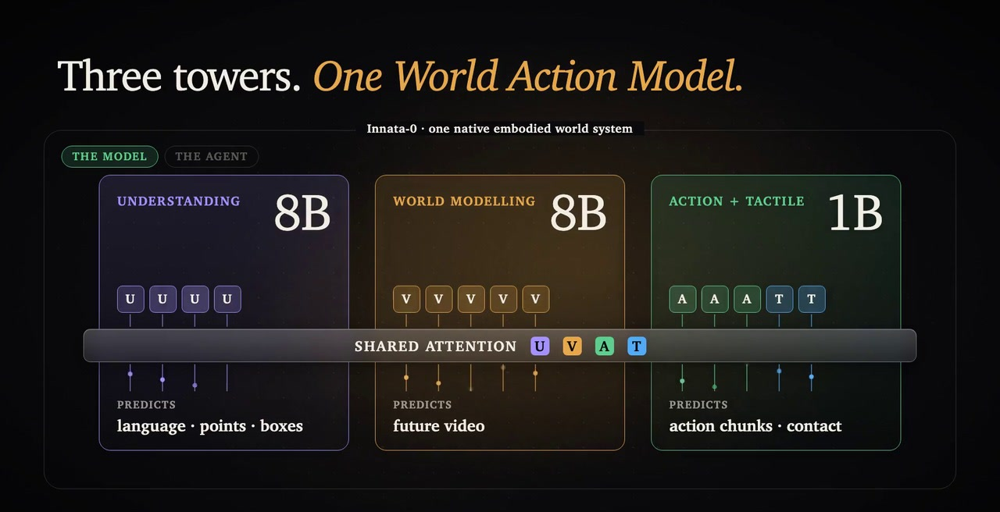

<!-- Copyright (c) 2026, BAAI. All rights reserved. -->
<!-- SPDX-License-Identifier: Apache-2.0 -->

# Innata Framework Inference

An inference runtime for **world action models (WAM)**. Given a visual
observation and a task instruction, WAM predicts an action chunk while jointly
modeling the future visual state. This repository provides the offline
inference path without a training loop.

Innata Framework builds on [NVIDIA Cosmos Framework](https://github.com/NVIDIA/cosmos-framework) and extends it for Innata-0 world action models.

[Project page](https://baai-eai.github.io/innata-0/) · Technical report ([arXiv](https://arxiv.org/abs/2611.30254) · [Hugging Face](https://huggingface.co/papers/2611.30254))



[Quick start](#quick-start) · [Release checkpoints](#release-checkpoint-inference) · [WAM inputs](#wam-inputs) ·
[Action output](#action-output) · [Checkpoint compatibility](#checkpoint-compatibility) ·
[Project layout](#project-layout) · [License](#license) ·
[Contributors](CONTRIBUTORS.md)

> [!IMPORTANT]
> **Release candidate.** Model weights and robot data are distributed separately.
> See [Release checkpoint inference](#release-checkpoint-inference) for the
> tested checkpoint-specific requests.

## WAM at a glance

| | Offline WAM |
| --- | --- |
| Input | A task instruction, camera observations and robot state in the checkpoint's input format. |
| Model | An action-capable checkpoint and its matching model configuration. |
| Output | A predicted action chunk in `sample_outputs.json`; the visual rollout is an auxiliary output. |
| Example | [Run the bundled RoboDojo request](#quick-start). |

For training, checkpoint conversion and export, see
[Innata Framework](https://github.com/baai-eai/innata-framework). Both
distributions use the `cosmos_framework` Python namespace and should be
installed in **separate environments**.

## Quick start

Install the inference environment from the repository root.

```bash
uv sync --no-dev --group cu130
```

Set `INNATA_CHECKPOINT` to your local Hugging Face
weights and `WAN_VAE` to your local Wan2.2 VAE. Run one of the bundled
examples on an idle GPU. The example already includes the observation,
request and robot state where applicable.

```bash
CUDA_VISIBLE_DEVICES=0 uv run --no-sync python examples/release-smoke/run.py robodojo \
  --checkpoint "${INNATA_CHECKPOINT:?set your local weights}" --vae "${WAN_VAE:?set your local VAE}"
```

The runner prints `PASS` after checking the output and reports the new
directory under `outputs/release-smoke/`. See the [smoke test guide](docs/release-smoke.md)
for installation and copyable commands for all four models.

## Release checkpoint inference

| Checkpoint | Hugging Face | Smoke test | Expected output |
| --- | --- | --- | --- |
| `Innata-0-Understanding` | [Weights](https://huggingface.co/BAAI/Innata-0-Understanding/tree/main) | `understanding` | Text response |
| `Innata-0-ACWM` | [Weights](https://huggingface.co/BAAI/Innata-0-ACWM/tree/main) | `acwm` | 17-frame MP4 |
| `Innata-0-WAM-RoboDojo` | [Weights](https://huggingface.co/BAAI/Innata-0-WAM-RoboDojo/tree/main) | `robodojo` | 16 × Joint14 |
| `Innata-0-WAM-RoboCasa365` | [Weights](https://huggingface.co/BAAI/Innata-0-WAM-RoboCasa365/tree/main) | `robocasa` | 16 × Control12 |

See the [evaluation guide](docs/release-evaluation.md) and the
[WorldArena guide](docs/acwm-worldarena.md) for paper benchmarks.

## WAM inputs

The [example request](examples/wam.json) contains:

```json
{
  "name": "wam_action",
  "model_mode": "wam",
  "prompt": "Pick up the object and place it on the tray.",
  "vision_path": "observation.png",
  "domain_name": "bridge_orig_lerobot",
  "view_point": "ego_view",
  "action_chunk_size": 16,
  "image_size": 256,
  "fps": 5,
  "seed": 42
}
```

| Field | Meaning |
| --- | --- |
| `model_mode` | `wam` predicts action and future vision conditioned on the first visual frame. |
| `prompt` / `vision_path` | Task text and the observation image or video. |
| `domain_name` | Selects the legacy action-domain mapping; it must match the checkpoint and robot representation. |
| `action_chunk_size` | Number of action steps requested. |
| `image_size`, `fps`, `view_point` | Observation preprocessing and temporal/viewpoint metadata. Match these to the checkpoint's training contract. |
| `seed` | Sampling seed. |

The generic offline path derives action width from its
[domain registry](cosmos_framework/data/generator/action/utils/domain_utils.py).
The example domain has 10 raw action dimensions. Some domains, including
`libero` and `hand_pose`, have variable widths and are not supported by this
generic WAM path. The request and model must agree on action ordering,
normalization, coordinate frames and timing.

## Action output

After a successful run, the action sequence is in
`outputs/wam/wam_action/sample_outputs.json` under
`outputs[0].content.action`:

```bash
uv run --no-sync python - <<'PY'
import json
from pathlib import Path

result = json.loads(Path("outputs/wam/wam_action/sample_outputs.json").read_text())
if result["status"] != "success":
    raise RuntimeError(result.get("message"))
actions = result["outputs"][0]["content"]["action"]
print(f"Predicted {len(actions)} action steps")
print("First step:", actions[0])
PY
```

The same sample directory may contain `vision.mp4` and other metadata. Action
units and normalization are checkpoint- and domain-specific: verify the
checkpoint's contract and evaluate the policy before using its outputs for
robot control.

## Checkpoint compatibility

`--checkpoint-path` accepts a registered model name or a local checkpoint
directory. Use an **action-capable WAM checkpoint**, not an arbitrary video-only
checkpoint. Local safetensors exports need matching model metadata or an
explicit `--config-file`; local model-only DCP loading needs a matching
standalone inference YAML. To supply one, add `--config-file "$WAM_CONFIG"`
to the command above after setting `WAM_CONFIG` to that file. These local
formats and custom WAM checkpoints have not been validated end to end in this
candidate.

The generic WAM template above uses legacy domains. Use the model-specific
templates in [Release checkpoint inference](#release-checkpoint-inference)
for RoboDojo and RoboCasa, whose Action128 contracts include State and
checkpoint-specific normalization.

Sampling defaults are in
[`defaults/wam/sample_args.json`](cosmos_framework/inference/defaults/wam/sample_args.json);
other modes are available in code but are not the focus of this release.

## Project layout

```text
cosmos_framework/
  inference/      WAM request handling, model setup and sampling
  model/          model, action and tokenizer implementations
  scripts/        offline inference entry point
examples/         WAM request template
```

## Optional FlagGems operators for text-to-video

[FlagGems](https://github.com/flagos-ai/FlagGems) provides optional Triton
implementations of PyTorch operators. Set up the Innata inference environment
first, then install the Python package into that environment. See the
[FlagGems documentation](https://flagos-ai.github.io/FlagGems/) and
[installation guide](https://flagos-ai.github.io/FlagGems/getting-started/install/).

```bash
uv pip install --python .venv/bin/python 'flag-gems==5.0.2'
```

From the repository root, set `VIDEO_CHECKPOINT` to a compatible video
checkpoint. If it needs a separate model configuration, pass
`--config-file path/to/config.yaml` before the heredoc. This example uses the
existing offline CLI and activates FlagGems only during generation.

```bash
uv run --no-sync python - \
  -i examples/text-to-video.json \
  -o outputs/t2v-flaggems \
  --checkpoint-path "${VIDEO_CHECKPOINT:?set a compatible video checkpoint}" \
  --seed 42 --no-use-torch-compile <<'PYTHON'
import flag_gems
from cosmos_framework.inference.common.inference import Inference
from cosmos_framework.scripts.inference import main

generate = Inference.generate

def generate_with_gems(self, *args, **kwargs):
    with flag_gems.use_gems(
        include=[
            "_index_put_impl_", "index_put", "index_put_",
            "sum", "sum_dim", "sum_out", "sum_dim_out",
        ],
    ):
        return generate(self, *args, **kwargs)

Inference.generate = generate_with_gems
main()
PYTHON
```

The example uses standard Triton. Direct FlashAttention 3 calls keep their
existing backend. Performance depends on the workload and hardware.

## License

BAAI-original code and other BAAI material marked Apache-2.0 are released
under the [Apache License 2.0](LICENSE). File headers identify the applicable
terms and provenance. NVIDIA Cosmos material retained in this repository,
including adapted upstream files, remains subject to its
[OpenMDW-1.1 license](LICENSES/OpenMDW-1.1.txt). See [NOTICE](NOTICE),
[ASSET_PROVENANCE.md](ASSET_PROVENANCE.md), [ATTRIBUTIONS.md](ATTRIBUTIONS.md), and
[LICENSES/](LICENSES/) for source and third-party terms. Model weights and
datasets have separate terms.
