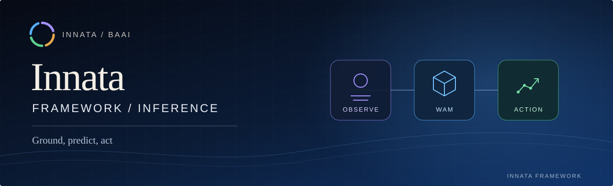

<!-- Copyright (c) 2026, BAAI. All rights reserved. -->
<!-- SPDX-License-Identifier: Apache-2.0 -->



# Innata Framework Inference

An inference runtime for **world action models (WAM)**. Given a visual
observation and a task instruction, WAM predicts an action chunk while jointly
modeling the future visual state. This repository provides the offline
inference path without a training loop.

[Quick start](#quick-start) · [WAM inputs](#wam-inputs) ·
[Action output](#action-output) · [Checkpoint compatibility](#checkpoint-compatibility) ·
[Project layout](#project-layout) · [License](#license) ·
[Contributors](CONTRIBUTORS.md)

> [!IMPORTANT]
> **Release candidate.** The WAM input and CPU-side batch construction have
> been checked; real-checkpoint GPU inference and clean installation have not
> been validated in this repository. Model weights and robot data are not
> included. The Action128 serving path and training-to-inference compatibility
> have not been released or validated here.

## WAM at a glance

| | Offline WAM |
| --- | --- |
| Input | A task instruction, an observation image or video, and a checkpoint-compatible action domain. WAM uses the first visual frame as the observation. |
| Model | An action-capable checkpoint and its matching model configuration. |
| Output | A predicted action chunk in `sample_outputs.json`; the visual rollout is an auxiliary output. |
| Example | [`examples/wam.json`](examples/wam.json), using the legacy `bridge_orig_lerobot` domain as a schema example. |

For training, checkpoint conversion and export, see
[Innata Framework](https://github.com/baai-eai/innata-framework). Both
distributions use the `cosmos_framework` Python namespace and should be
installed in **separate environments**.

## Quick start

### 1. Install

The CUDA 13.0 group targets Linux, Python **3.13**, an NVIDIA GPU and
[uv](https://docs.astral.sh/uv/) **0.11.3 or newer**. GPU requirements depend
on the checkpoint and have not been measured for this candidate. Installation
needs access to the configured PyTorch and NVIDIA wheel indexes.

```bash
git clone https://github.com/baai-eai/innata-framework-inference.git
cd innata-framework-inference

export UV_PROJECT_ENVIRONMENT=.venv
uv sync --no-dev --group cu130 --extra guardrail
uv run --no-sync innata-infer --help
```

### 2. Prepare an observation and checkpoint

Provide a PNG observation and a WAM checkpoint that supports the example's
`bridge_orig_lerobot` domain. The domain and action representation **must
match the checkpoint**; the example's values are not a universal robot
control format. If using a different robot or checkpoint, edit the request to
match its published contract.

```bash
export OBSERVATION_PNG='path/to/your/observation.png'
export WAM_CHECKPOINT='path/to/your/wam-checkpoint'

mkdir -p outputs/wam-request
cp examples/wam.json outputs/wam-request/sample.json
cp "$OBSERVATION_PNG" outputs/wam-request/observation.png
```

Paths inside a JSON request are resolved relative to that JSON file. The
checkpoint directory must contain the matching model configuration or be
accompanied by an explicit inference configuration; see
[Checkpoint compatibility](#checkpoint-compatibility).

### 3. Generate an action chunk

```bash
uv run --no-sync innata-infer \
  -i outputs/wam-request/sample.json \
  -o outputs/wam \
  --checkpoint-path "$WAM_CHECKPOINT" \
  --seed 42
```

The model, its tokenizer/VAE and any enabled guardrails may require separate
downloads and terms. This command is a starting point, not a verified
end-to-end GPU run.

## WAM inputs

The [example request](examples/wam.json) contains:

```json
{
  "name": "wam_action",
  "model_mode": "wam",
  "prompt": "Pick up the object and place it on the tray.",
  "vision_path": "observation.png",
  "domain_name": "bridge_orig_lerobot",
  "view_point": "ego_view",
  "action_chunk_size": 16,
  "image_size": 256,
  "fps": 5,
  "seed": 42
}
```

| Field | Meaning |
| --- | --- |
| `model_mode` | `wam` predicts action and future vision conditioned on the first visual frame. |
| `prompt` / `vision_path` | Task text and the observation image or video. |
| `domain_name` | Selects the legacy action-domain mapping; it must match the checkpoint and robot representation. |
| `action_chunk_size` | Number of action steps requested. |
| `image_size`, `fps`, `view_point` | Observation preprocessing and temporal/viewpoint metadata. Match these to the checkpoint's training contract. |
| `seed` | Sampling seed. |

The generic offline path derives action width from its
[domain registry](cosmos_framework/data/generator/action/utils/domain_utils.py).
The example domain has 10 raw action dimensions. Some domains, including
`libero` and `hand_pose`, have variable widths and are not supported by this
generic WAM path. The request and model must agree on action ordering,
normalization, coordinate frames and timing.

## Action output

After a successful run, the action sequence is in
`outputs/wam/wam_action/sample_outputs.json` under
`outputs[0].content.action`:

```bash
uv run --no-sync python - <<'PY'
import json
from pathlib import Path

result = json.loads(Path("outputs/wam/wam_action/sample_outputs.json").read_text())
if result["status"] != "success":
    raise RuntimeError(result.get("message"))
actions = result["outputs"][0]["content"]["action"]
print(f"Predicted {len(actions)} action steps")
print("First step:", actions[0])
PY
```

The same sample directory may contain `vision.mp4` and other metadata. Action
units and normalization are checkpoint- and domain-specific: verify the
checkpoint's contract and evaluate the policy before using its outputs for
robot control.

## Checkpoint compatibility

`--checkpoint-path` accepts a registered model name or a local checkpoint
directory. Use an **action-capable WAM checkpoint**, not an arbitrary video-only
checkpoint. Local safetensors exports need matching model metadata or an
explicit `--config-file`; local model-only DCP loading needs a matching
standalone inference YAML. To supply one, add `--config-file "$WAM_CONFIG"`
to the command above after setting `WAM_CONFIG` to that file. These local
formats and custom WAM checkpoints have not been validated end to end in this
candidate.

The generic offline CLI uses the legacy domain IDs above. Action128 requires a
separate source-domain, 128-slot mask and normalization contract. Although
some Action128 request helpers are present in the code, this repository does
not currently expose a standalone Action128 HTTP server or a validated
Action128 checkpoint-to-action workflow. Do not assume the generic sample
implements that contract.

Sampling defaults are in
[`defaults/wam/sample_args.json`](cosmos_framework/inference/defaults/wam/sample_args.json);
other modes are available in code but are not the focus of this release.

## Project layout

```text
cosmos_framework/
  inference/      WAM request handling, model setup and sampling
  model/          model, action and tokenizer implementations
  scripts/        offline inference entry point
examples/         WAM request template
```

## License

File headers identify BAAI-original work and adapted or copied upstream code.
See [LICENSE](LICENSE), [LICENSES](LICENSES/), [NOTICE](NOTICE), and
[COPYRIGHTS.md](COPYRIGHTS.md). Checkpoint and dataset licenses are separate
from the code license.
